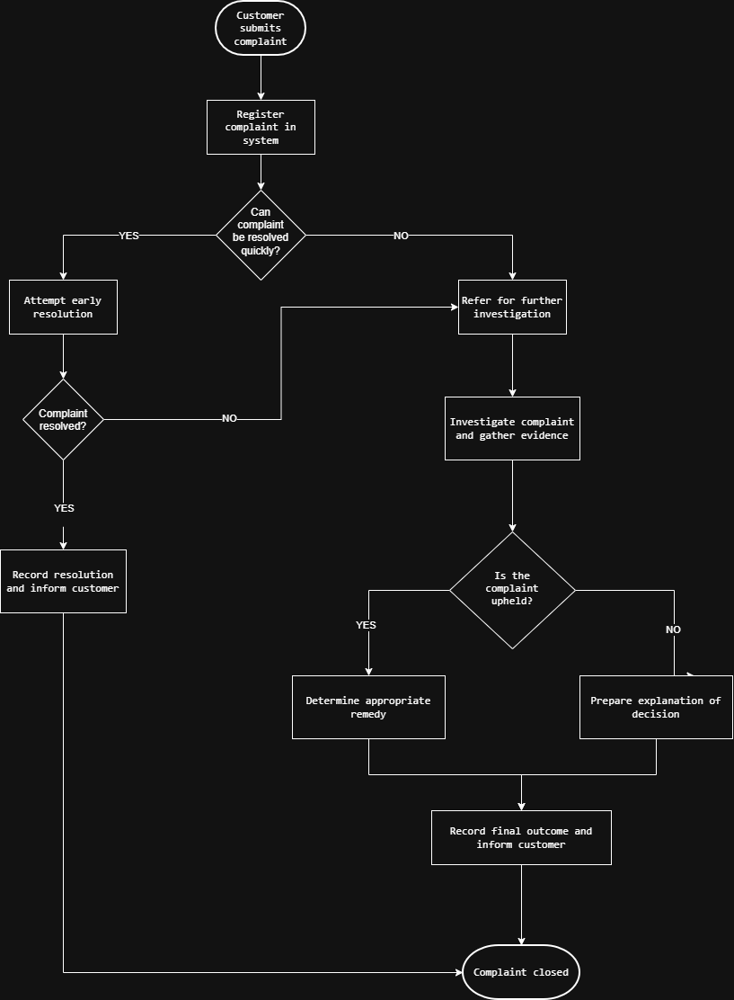
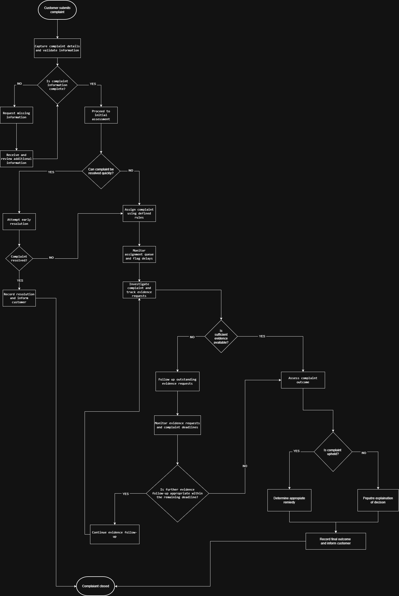
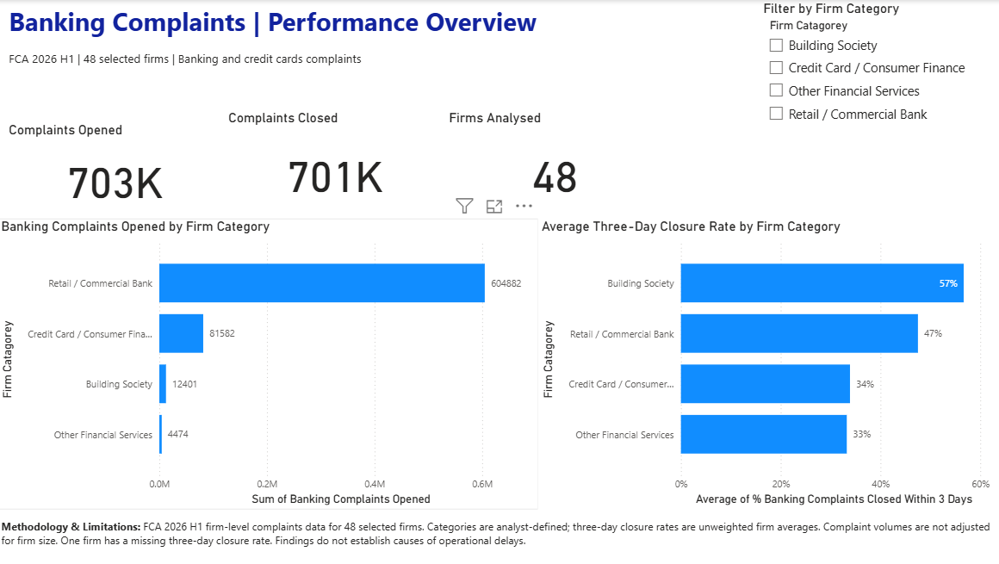
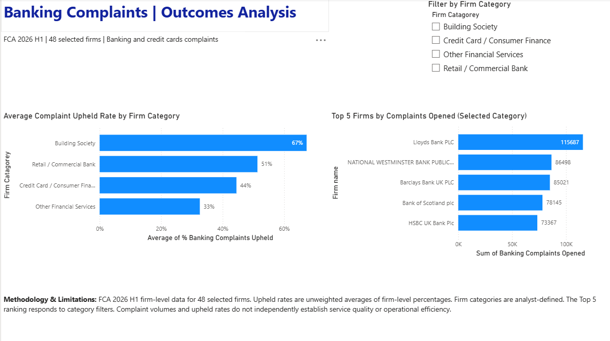

# UK Banking Complaints Performance & Process Improvement

**Project Type:** Independent Business Analysis Project

**Industry:** UK Financial Services (Banking)

**Project Status**: Completed — Portfolio Case Study

---

## 1. Project Overview

This independent Business Analyst portfolio project examines customer complaints-handling performance across 48 selected UK financial firms using publicly available Financial Conduct Authority (FCA) complaints data for January–June 2026.

The project analyses complaint volumes, three-day closure percentages and upheld complaint rates, highlighting differences between analyst-defined financial firm categories and individual firms.

The findings were used to identify areas requiring further investigation, develop three proposed business requirements and design illustrative AS-IS and TO-BE complaints-handling processes. The project also includes an interactive Power BI dashboard, a KPI framework and business recommendations.

Because internal operational data was unavailable, the process maps and recommendations represent illustrative proposals rather than verified processes or proven solutions implemented by individual financial firms.

## 2. Business Problem

UK banking firms receive substantial volumes of customer complaints, creating a need for effective complaint investigation, resolution and monitoring.

Initial analysis of Financial Conduct Authority (FCA) data for January–June 2026 shows differences in the percentage of banking and credit-card complaints closed within three days across five selected high-volume UK banking firms. For example, HSBC UK Bank Plc recorded approximately 60%, compared with 48% for National Westminster Bank, a difference of approximately 12 percentage points.

These differences raise questions about the factors affecting complaint resolution times. Potential influences include complaint complexity, case allocation, investigation procedures and operational capacity.

The business challenge is to understand variations in complaint-handling performance and identify opportunities to improve resolution efficiency while maintaining fair customer outcomes.

As this project uses publicly available aggregated data, internal process bottlenecks cannot be confirmed. Any proposed improvements will therefore be presented as recommendations for a hypothetical banking complaints operation rather than proven solutions to problems at specific firms.

## 3. Project Objectives

The primary objective of this project is to evaluate customer complaints-handling performance across selected UK banking firms and explore opportunities for improving complaint resolution efficiency.

**Specific objectives:**

1. Analyse the volume of customer complaints opened and closed by UK banking firms during January–June 2026.
2. Compare complaints resolution performance using the percentage of complaints closed within three days.
3. Examine upheld complaint percentages to understand differences in complaint outcomes.
4. Identify performance variations and develop questions for further investigation.
5. Develop an illustrative AS-IS complaints-handling process based on clearly stated assumptions.
6. Propose a TO-BE complaints-handling process, supported by business requirements and potential improvement opportunities.
7. Present the findings through an Excel analysis, Power BI dashboard and concise business recommendations report.

**Expected outcome:** A structured Business Analyst case study demonstrating data analysis, performance evaluation, process mapping, requirements development and evidence-informed recommendations.

## 4. Project Scope

**In Scope**

- Analysis of publicly available FCA firm-level complaints data for January–June 2026.
- Identification of relevant UK banking firms using the banking and credit-card complaints category.
- Comparison of complaints opened, complaints closed, three-day closure percentages and upheld complaint percentages.
- Identification of performance differences and areas requiring further investigation.
- Development of an illustrative complaints-handling AS-IS process.
- Design of an improved TO-BE process supported by business requirements.
- Creation of an Excel analysis, Power BI dashboard and recommendations report.

**Out of Scope**

- Access to individual customer complaint records or confidential bank information.
- Investigation of actual employee performance or internal operational systems.
- Claims about the proven causes of complaint delays at individual banks.
- Implementation or testing of proposed improvements within real organisations.
- Historical trend analysis beyond the selected reporting period.
- Analysis of US financial institutions.

**Project Boundaries**

This is an independent portfolio case study, not a consultancy engagement commissioned by any bank. The data analysis uses publicly available FCA information, while process diagrams and improvement recommendations will be explicitly identified as illustrative proposals.

## 5. Business Analysis Methodology

This project follows a structured Business Analysis approach combining quantitative data analysis with illustrative business process improvement techniques.

**1. Data Collection and Preparation**

Collected and prepared publicly available FCA complaints data for January–June 2026. Selected 48 financial firms with reported banking and credit-card complaints and organised the relevant data in Microsoft Excel.

**2. Complaints Performance Analysis**

Analysed complaint volumes, three-day closure percentages and upheld rates using Excel and Power BI. Compared analyst-defined firm categories, examined the relationship between complaint volumes and early closure performance, and conducted a sensitivity analysis.

**3. Stakeholder Analysis**

Identified hypothetical stakeholder roles, including complaints managers, complaints handlers, compliance officers, operations managers, IT teams and customers. Documented their responsibilities, interests and potential influence.

**4. AS-IS Process Mapping**

Developed an illustrative complaints-handling process using draw.io, covering complaint registration, early resolution, investigation and closure. Clearly distinguished assumed process activities from findings supported by FCA data.

**5. Potential Process Bottleneck Assessment**

Identified three potential bottlenecks involving complaint registration, assignment and investigation. Assessed possible impacts and documented the internal operational evidence required to validate these hypotheses.

**6. Business Requirements Analysis**

Developed three proposed business requirements addressing complaint assignment, investigation monitoring and information validation. Created a Requirements Traceability Matrix linking each requirement to a potential bottleneck and relevant KPI.

**7. TO-BE Process Mapping**

Designed a proposed improved complaints-handling workflow incorporating information validation, defined assignment rules, queue monitoring and evidence-request tracking.

**8. KPI Development and Recommendations**

Defined five performance indicators, distinguishing measures available from FCA data from those requiring internal operational data. Developed three business recommendations and created a two-page interactive Power BI dashboard to communicate the findings.

**Methodological Limitation**

This is an independent portfolio project using public, aggregated complaints data. No interviews, internal process observations or operational testing have been conducted. Proposed process improvements will therefore be illustrative rather than verified solutions for any specific bank.

**Data Source**

**Organisation:** Financial Conduct Authority (FCA)

**Dataset:** Firm-level complaints data — 2026 H1

**Reporting period:** January–June 2026

**Published:** 22 October 2026

**Official source:** [https://www.fca.org.uk/data/complaints-data-2026-h1](https://www.fca.org.uk/data/complaints-data-2026-h1)

**Dataset selection:** This project analysed 48 selected firms reporting banking and credit-card complaints. The sample is not representative of every UK financial firm.

**Data preparation:** Relevant complaint volumes, three-day closure percentages and upheld percentages were extracted and organised in Excel. Firm categories were defined by the analyst for comparison purposes and are not official FCA classifications.

## 6. Stakeholder Analysis

### Purpose

Stakeholder analysis identifies the individuals and groups involved in, affected by, or responsible for a banking complaints-handling process.

This project uses publicly available FCA complaints data and does not involve direct engagement with banking employees. The following stakeholder roles and their interests are therefore illustrative assumptions for a hypothetical banking complaints operation.

### Identified Stakeholders

**1. Complaints Manager**

- Responsibility: Oversees complaint investigations, resolution performance and team operations.
- Interest: Improving complaint resolution efficiency while maintaining appropriate customer outcomes.
- Influence: High.
- Priority: High.

**2. Complaints Handling Team**

- Responsibility: Receives, investigates and resolves customer complaints.
- Interest: Clear procedures, effective case allocation and manageable workloads.
- Influence: Medium.
- Priority: High.

**3. Compliance Officer**

- Responsibility: Monitors compliance with relevant complaints-handling requirements and internal policies.
- Interest: Ensuring complaints are handled fairly, consistently and in accordance with regulatory obligations.
- Influence: High.
- Priority: High.

**4. Operations Manager**

- Responsibility: Oversees operational processes, resources and service performance.
- Interest: Reducing unnecessary processing delays and improving operational efficiency.
- Influence: High.
- Priority: High.

**5. IT / Systems Team**

- Responsibility: Maintains and supports complaint management systems.
- Interest: System reliability, accurate information and opportunities for workflow improvements.
- Influence: Medium.
- Priority: Medium.

**6. Customers**

- Responsibility: Submit complaints, provide relevant information and receive complaint outcomes.
- Interest: Fair treatment, clear communication and timely resolution.
- Influence: Medium.
- Priority: High.

### Stakeholder Analysis Summary

The Complaints Manager, Compliance Officer and Operations Manager are assumed to be key decision-makers in a hypothetical complaints process improvement initiative.

Complaints handlers and IT staff would provide operational and technical information needed to understand existing workflows and potential bottlenecks.

Customer feedback would help assess whether proposed improvements support fair outcomes and a better customer experience.

### Key Assumptions

The stakeholder roles, responsibilities and influence levels are illustrative. They have not been validated through interviews or internal banking documentation.

In a real Business Analyst engagement, stakeholder interviews and workshops would be required to confirm responsibilities, understand process challenges and validate business requirements.

## 7. Tools & Technologies Used

- **Microsoft Excel:** FCA data preparation, validation, exploratory analysis and statistical calculations.
- **Microsoft Power BI:** Interactive dashboard development, data visualisation and firm-category comparisons.
- **draw.io (diagrams.net):** Illustrative AS-IS and proposed TO-BE process mapping.
- **Notion:** Project documentation, business requirements, gap analysis and recommendations.

## 8. Project Deliverables

**Completed Project Deliverables**

- **FCA Data Analysis Workbook:** Cleaned and validated complaint data for 48 selected firms, including category comparisons, correlation analysis and a sensitivity check.
- **Stakeholder Analysis:** Identification of relevant stakeholder roles, responsibilities, interests and influence within a hypothetical banking complaints operation.
- **AS-IS Process Map:** Illustrative banking complaints workflow showing registration, early resolution, investigation and closure.
- **Process Bottleneck Assessment:** Three potential bottlenecks relating to registration, assignment and investigation, with evidence gaps identified.
- **KPI Framework:** Five proposed or available performance indicators, including definitions, purposes, measurement approaches and data requirements.
- **Business Requirements and RTM:** Three business requirements with a requirements traceability matrix.
- **TO-BE Process Map:** Proposed improved workflow incorporating information validation, assignment queue monitoring and evidence tracking.
- **Process Gap Analysis:** Comparison of the illustrative AS-IS and proposed TO-BE workflows.
- **Business Recommendations:** Three proposed operational improvements with associated KPIs and implementation considerations.
- **Power BI Dashboard:** Interactive two-page report covering complaint volumes, three-day closure rates, upheld rates and firm comparisons.
- **Portfolio Documentation:** Complete case study and conclusion documented in Notion.

**Project status:** Analysis, proposed process design, recommendations and dashboard development completed. The proposed operational improvements have not been implemented or validated within a real banking organisation.

## 9. Analysis and Findings

**Finding 1: Differences in Three-Day Complaint Closure Performance**

Analysis of FCA firm-level complaints data for January–June 2026 identified differences in average three-day complaint closure percentages across the four analyst-defined financial firm categories.

Building societies recorded the highest unweighted average three-day closure percentage at approximately 57%, followed by retail/commercial banks at 47%, credit-card/consumer-finance firms at 34%, and other financial services firms at 33%.

The difference between building societies and other financial services firms was approximately 24 percentage points.

These findings highlight variations in reported complaint-resolution performance. However, the data does not establish the reasons for these differences. Complaint complexity, business models, customer bases and operational arrangements may influence the results.

Because these are unweighted averages of firm-level percentages, they should not be interpreted as the proportion of all complaints resolved within three days across each category.

**Business implication:** The observed differences warrant further investigation before recommending changes to complaints-handling processes.

**Finding 2: Relationship Between Complaint Volume and Resolution Speed**

An exploratory correlation analysis was conducted to investigate the relationship between banking and credit-card complaint volumes and three-day complaint closure percentages.

The analysis included 47 firms with available numerical resolution percentages. One firm, Kroo Bank Ltd, was excluded because its three-day closure percentage was unavailable in the matched dataset.

The Pearson correlation coefficient was **r = +0.183**, indicating a weak positive linear relationship between complaint volumes opened and three-day closure percentages.

This suggests that complaint volumes alone are not strongly associated with resolution performance in the selected sample.

**Business implication:** Complaint-handling efficiency should not be assessed using complaint volumes alone. Additional information about complaint complexity, case allocation, operational processes and staffing would be needed to investigate potential causes of performance differences.

**Limitations:** The analysis is observational, uses firm-level aggregated data and does not establish causation. The findings may also be influenced by differences in firm size, business activities and individual high-volume firms.

**Sensitivity Analysis: Excluding the Highest-Volume Firm**

A sensitivity analysis was conducted to assess whether Lloyds Bank PLC, the firm with the highest banking and credit-card complaint volume (115,687), had a substantial influence on the observed correlation.

The original Pearson correlation coefficient was **r = +0.183**, based on 47 firms with available three-day closure percentages.

After excluding Lloyds Bank PLC, the correlation decreased slightly to **r = +0.166**, based on 46 firms.

The small change of 0.017 indicates that the weak positive relationship is not driven solely by the highest-volume firm.

**Interpretation:** Complaint volume shows only a weak linear association with three-day closure performance in this sample. The result does not establish causation, and other firm characteristics or unusually large observations may influence the relationship.

**Finding 3: Three-Day Closure Performance Among Five High-Volume Banking Firms**

A focused comparison was conducted using the five firms reporting the highest banking and credit-card complaint volumes in the selected FCA dataset for January–June 2026.

HSBC UK Bank Plc recorded the highest three-day complaint closure percentage at approximately 60%, followed by Barclays Bank UK PLC at 57%, Lloyds Bank PLC and Bank of Scotland plc at 56%, and National Westminster Bank at 48%.

The difference between HSBC and National Westminster Bank was approximately **12 percentage points**.

**Business implication:** These differences highlight an opportunity to investigate variations in complaint-handling practices, case complexity, resource allocation and operational processes.

**Limitations:** The FCA data does not provide sufficient internal operational information to identify the causes of these differences. Higher three-day closure percentages should not automatically be interpreted as evidence of better customer service or more efficient internal processes.

**Recommended next investigation:** Compare complaint types, case complexity, allocation procedures and resolution workflows before proposing specific improvements.

## 10. AS-IS Process Diagram

### AS-IS Banking Complaints Process Map

                                      **Figure 1: Illustrative AS-IS Banking Complaints Process Map**

This diagram illustrates a hypothetical banking complaints-handling process, from initial complaint registration through early resolution or further investigation to final closure.

The process map was developed as part of an independent Business Analyst portfolio case study. It does not represent a verified internal workflow of any specific financial institution.

The diagram provides a basis for identifying potential process bottlenecks, defining business requirements, and developing proposed TO-BE improvements.

**Potential Bottleneck 1: Complaint Investigation**

**Process stage:** Investigate complaint and gather evidence

**Potential issue:** Complaints may experience delays during investigation if handlers need to request additional evidence, coordinate with other departments, or wait for information.

**Possible business impact:** Longer complaint resolution times, increased outstanding complaint volumes, and reduced customer satisfaction.

**Evidence status:** Hypothesis only. The FCA firm-level dataset provides complaint volumes and closure percentages but does not establish the causes of investigation delays.

**Further evidence required:** Case-level investigation timestamps, queue waiting times, workload information, and interviews with complaints-handling staff.

**Potential Bottleneck 2: Complaint Referral and Assignment**

**Process stage:** Refer for further investigation

**Potential issue:** Complaints may remain in an assignment queue before a complaints handler begins investigating them. This could happen if responsibilities are unclear, cases require specialist teams, or available staff cannot immediately handle incoming complaints.

**Possible business impact:** Increased waiting times, longer complaint resolution times, and a growing backlog of unresolved complaints.

**Evidence status:** Hypothesis only. The FCA dataset does not contain individual complaint assignment times, staffing information, or queue lengths.

**Further evidence required:** Complaint referral and assignment timestamps, queue lengths, staffing capacity, and interviews with complaints managers.

**Potential Bottleneck 3: Complaint Registration**

**Process stage:** Register complaint in system

**Potential issue:** Complaint registration may involve manual data entry, incomplete customer information, or repeated administrative checks. These activities could delay the initial assessment of a complaint.

**Possible business impact:** Increased administrative workload, delayed complaint assessment, potential data-entry errors, and slower progression to resolution.

**Evidence status:** Hypothesis only. The FCA dataset does not provide information about complaint registration methods, time spent entering data, or administrative error rates.

**Further evidence required:** Registration timestamps, average registration time, data-entry error rates, complaint submission records, and interviews with complaints-handling staff.

### Bottleneck Prioritisation Matrix

**Purpose:** Compare the three potential bottlenecks and determine which should be investigated first.

| Potential bottleneck | Business impact | Likelihood | Evidence confidence | Investigation priority |
| --- | --- | --- | --- | --- |
| Complaint investigation delays | To assess | To assess | Low | To determine |
| Complaint referral and assignment delays | To assess | To assess | Low | To determine |
| Complaint registration delays | To assess | To assess | Low | To determine |

**Assessment approach:** Business impact and likelihood will be evaluated using operational information and stakeholder input. Evidence confidence is currently low because the available FCA dataset does not identify the internal causes of complaint-handling delays.

**Current decision:** No bottleneck has been confirmed or ranked. Further evidence is needed before making an evidence-based prioritisation decision.

**Linking FCA Findings to Potential Process Bottlenecks**

**Relevant finding:** The unweighted average percentage of banking complaints closed within three days was approximately 47% for the Retail / Commercial Bank category and 34% for the Credit Card / Consumer Finance category in the selected 2026 H1 firms.

**Interpretation:** This 13-percentage-point difference indicates variation in short-term complaint closure performance between the two analyst-defined firm categories. It does not establish the causes of that variation.

**Potential process areas for further investigation:**

- Complaint registration and initial assessment
- Complaint referral and assignment
- Complaint investigation and evidence gathering

**Key limitation:** The FCA dataset contains firm-level complaint statistics rather than individual complaint timelines. Therefore, it cannot show how long complaints spend at each process stage or establish which activities cause delays.

**Recommended next analysis:** Obtain operational data on registration, referral, investigation and closure times, alongside stakeholder interviews, to assess potential bottlenecks.

**Conclusion:** The FCA findings justify further process investigation but do not confirm that any of the three proposed bottlenecks are occurring.

## 11. Proposed Process KPIs

**KPI 1: Average Complaint Resolution Time**

**Definition:** The average number of calendar days taken to resolve and close a complaint, measured from the date the complaint is received to the date it is closed.

**Formula:** Total resolution days for complaints closed during the reporting period ÷ Total number of complaints closed during that period.

**Business purpose:** Monitor overall complaint-handling efficiency and identify changes in resolution performance over time.

**Required data:**

- Complaint ID
- Complaint received date
- Complaint closed date
- Complaint status

**Data availability:** Not directly calculable from the current FCA firm-level dataset. Individual complaint timestamps would be required.

**Suggested reporting frequency:** Monthly.

**Proposed target:** To be agreed after establishing a baseline and reviewing applicable regulatory requirements.

**KPI 2: Average Complaint Assignment Waiting Time**

**Definition:** The average elapsed time between referring a complaint for further investigation and assigning it to a complaints handler.

**Formula:** Total referral-to-assignment hours ÷ Number of referred complaints assigned during the reporting period.

**Business purpose:** Identify potential delays in complaint allocation and monitor whether assignment queues are affecting the efficiency of the complaints-handling process.

**Required data:**

- Complaint ID
- Referral timestamp
- Assignment timestamp
- Assigned handler or team

**Data availability:** Not calculable from the current FCA firm-level dataset. Internal complaint-management records would be required.

**Suggested reporting frequency:** Weekly or monthly.

**Proposed target:** To be established after measuring current assignment waiting times and consulting relevant stakeholders.

**Important distinction:** Assignment waiting time measures when a complaint is allocated to a handler, not when investigation actually begins. A separate metric would be needed to measure any additional waiting time after assignment.

**KPI 3: Average Complaint Investigation Time**

**Definition:** The average elapsed time between the start and completion of a complaint investigation.

**Formula:** Total elapsed investigation hours for investigations completed during the reporting period ÷ Number of investigations completed during that period.

**Business purpose:** Monitor investigation duration and help identify potential delays in evidence gathering, internal communication, or complaint assessment.

**Required data:**

- Complaint ID
- Investigation start timestamp
- Investigation completion timestamp
- Investigation status
- Complaint category

**Data availability:** Not calculable from the current FCA firm-level dataset. Internal case-level investigation records would be required.

**Suggested reporting frequency:** Weekly or monthly.

**Proposed target:** To be established after measuring current investigation times and consulting complaints-management stakeholders.

**Measurement limitation:** Elapsed investigation time includes both active work and waiting periods. Additional timestamps or activity logs would be necessary to distinguish processing time from waiting time.

**KPI 4: Three-Day Complaint Closure Rate**

**Definition:** The percentage of eligible closed complaints that were resolved within three business days of receipt, following the applicable FCA reporting definition.

**Business purpose:** Monitor early complaint resolution performance and compare reported outcomes across firms or reporting periods.

**Measurement approach:** Use the FCA-reported three-day closure percentage. Where calculating from internal data, apply the FCA's eligibility rules and reporting definitions to the numerator and denominator.

**Required data:**

- Complaint ID
- Complaint received date
- Complaint resolution and closure dates
- Complaint eligibility and status information

**Data availability:** Available at firm level in the FCA 2026 H1 dataset. Individual complaint-level records are not available in the current project.

**Existing project finding:** The selected Retail / Commercial Bank firms had an unweighted average three-day closure rate of approximately 47%, compared with 34% for Credit Card / Consumer Finance firms.

**Suggested reporting frequency:** Monthly for internal monitoring, with comparisons to published FCA reporting periods where appropriate.

**Proposed target:** To be determined after reviewing the baseline, complaint mix, relevant FCA requirements, and stakeholder expectations.

**Limitation:** A higher three-day closure rate does not, by itself, prove better customer outcomes or greater process efficiency. Comparisons may be influenced by complaint type, complexity, and differences between firms.

**KPI 5: Complaint Upheld Rate**

**Definition:** The percentage of closed complaints that were upheld by the financial firm, either fully or partially, using the applicable FCA reporting definition.

**Formula:** Number of upheld complaints ÷ Number of closed complaints × 100, applying the relevant FCA reporting rules.

**Business purpose:** Monitor complaint outcomes, identify patterns that may require further investigation, and support improvements in customer service and operational processes.

**Required data:**

- Complaint ID
- Complaint category
- Complaint status
- Final complaint outcome (upheld or not upheld)
- Complaint closure date

**Data availability:** Available at firm level in the FCA 2026 H1 dataset, including the Banking and credit cards complaint category analysed in this project.

**Suggested reporting frequency:** Monthly for internal monitoring, with comparisons against published FCA reporting periods.

**Proposed target:** No numerical target has been established. Any performance objective should consider complaint fairness, regulatory expectations, and customer outcomes rather than simply aiming to reduce the upheld rate.

**Limitations:** The upheld rate alone does not identify the causes of complaints or demonstrate whether the complaint-handling process is efficient. Additional information about complaint categories, root causes and individual cases would be required.

### KPI Summary and Data Availability

| KPI | Business purpose | Data source | Current status |
| --- | --- | --- | --- |
| Average Complaint Resolution Time | Measure end-to-end complaint resolution time | Internal complaint management system | Proposed — data required |
| Average Complaint Assignment Waiting Time | Identify delays between referral and assignment | Internal complaint management system | Proposed — data required |
| Average Complaint Investigation Time | Monitor investigation duration and potential delays | Internal complaint management system | Proposed — data required |
| Three-Day Complaint Closure Rate | Monitor early complaint closure performance | FCA 2026 H1 firm-level complaints dataset | Available — analysed |
| Complaint Upheld Rate | Monitor complaint outcomes | FCA 2026 H1 firm-level complaints dataset | Available — analysis possible |

**Data availability summary:** Two KPIs are available from published FCA firm-level statistics. Three additional KPIs are proposed and would require internal case-level data.

**Recommendation:** Use available FCA statistics to understand reported complaint outcomes and identify questions for further investigation. Obtain internal operational data before evaluating process bottlenecks or measuring the impact of proposed improvements.

## 12. Business Requirements

**BR-01: Timely Complaint Assignment**

**Requirement ID:** BR-01

**Business requirement:** The organisation should ensure that complaints requiring further investigation are assigned to an appropriate complaints handler within an agreed timeframe.

**Business problem addressed:** Potential delays between complaint referral and assignment.

**Business objective:** Reduce unnecessary waiting time and support timely complaint investigation.

**Related KPI:** Average Complaint Assignment Waiting Time (KPI 2).

**Stakeholders:** Complaints Manager, Complaints Handlers, Operations Manager.

**Success criteria:** A measurable assignment-time target is agreed with stakeholders, and performance against that target can be monitored.

**Priority:** To be determined following stakeholder consultation.

**Status:** Proposed requirement for the illustrative TO-BE process; not validated by a real banking stakeholder.

**BR-02: Efficient Complaint Investigation**

**Requirement ID:** BR-02

**Business requirement:** The organisation should ensure that complaints requiring investigation can be monitored throughout the investigation process, including the status of evidence requests and outstanding actions.

**Business problem addressed:** Potential delays caused by evidence gathering, internal communication, and limited visibility of investigation progress.

**Business objective:** Improve investigation visibility, reduce avoidable delays, and support timely complaint resolution.

**Related KPI:** Average Complaint Investigation Time (KPI 3).

**Stakeholders:** Complaints Manager, Complaints Handlers, Operations Manager, Compliance Officer.

**Success criteria:** Investigation start and completion times can be recorded, outstanding information requests can be identified, and investigation duration can be monitored against an agreed baseline and target.

**Priority:** To be determined following stakeholder consultation.

**Status:** Proposed requirement for the illustrative TO-BE process; not validated by a real banking stakeholder.

**BR-03: Accurate and Efficient Complaint Registration**

**Requirement ID:** BR-03

**Business requirement:** The organisation should ensure that customer complaints are registered accurately, consistently, and within an agreed timeframe, with sufficient information to support initial assessment.

**Business problem addressed:** Potential registration delays, incomplete complaint records, and manual data-entry errors.

**Business objective:** Improve complaint data quality, reduce unnecessary administrative effort, and support timely initial assessment.

**Related KPI:** Average Complaint Resolution Time (KPI 1). A separate registration-time KPI may be introduced if internal data becomes available.

**Stakeholders:** Complaints Handlers, Complaints Manager, Operations Manager, IT Team, Compliance Officer.

**Success criteria:** Required complaint information is consistently recorded, registration errors can be monitored, and registration times can be measured against an agreed target.

**Priority:** To be determined following stakeholder consultation.

**Status:** Proposed requirement for the illustrative TO-BE process; not validated by a real banking stakeholder.

### Requirements Traceability Matrix (RTM)

| Requirement ID | Business requirement | Potential bottleneck addressed | Related KPI | Status |
| --- | --- | --- | --- | --- |
| BR-01 | Timely Complaint Assignment | Complaint referral and assignment delays | KPI 2: Average Assignment Waiting Time | Proposed |
| BR-02 | Efficient Complaint Investigation | Investigation and evidence-gathering delays | KPI 3: Average Investigation Time | Proposed |
| BR-03 | Accurate and Efficient Complaint Registration | Registration delays and possible data-entry errors | KPI 1: Average Resolution Time | Proposed |

**Purpose:** Establish traceability between the identified process concerns, proposed business requirements and performance measures.

**Validation status:** All three requirements are hypothetical and have not been validated with real banking stakeholders.

**Outcome:** The three proposed business requirements have been mapped to the illustrative TO-BE complaints-handling process. Each requirement addresses a potential process bottleneck and is linked to an appropriate performance indicator. These requirements remain subject to stakeholder validation before implementation.

**Measurement gap:** BR-03 would benefit from additional KPIs such as average registration time and registration error rate. These would require internal operational data.

## 13. Proposed TO-BE Process

                                       **Figure 2: Proposed TO-BE Banking Complaints Process Map**

The TO-BE process map presents a proposed improved banking complaints-handling workflow developed from the illustrative AS-IS process and three business requirements.

**Key proposed improvements:**

- **BR-01 — Timely Complaint Assignment:** Defined assignment rules and queue monitoring to identify potential allocation delays.
- **BR-02 — Efficient Complaint Investigation:** Evidence-request tracking, structured follow-up and complaint deadline monitoring.
- **BR-03 — Accurate and Efficient Complaint Registration:** Initial information validation and a feedback loop for requesting and reviewing missing details.

**Expected benefits:** These changes may improve process visibility, data quality, complaint allocation and investigation monitoring.

**Limitations:** The improvements have not been implemented or tested. Their effectiveness would need to be evaluated using internal complaint-management data, stakeholder feedback and agreed performance measures.

## 14. AS-IS vs TO-BE Gap Analysis

### Process Gap Analysis

| Process area | Illustrative AS-IS | Proposed TO-BE | Requirement |
| --- | --- | --- | --- |
| Complaint registration | Register complaint in system | Capture and validate complaint details, with missing-information follow-up | BR-03 |
| Complaint assignment | Refer for further investigation | Use defined assignment rules and monitor assignment queues | BR-01 |
| Complaint investigation | Investigate complaint and gather evidence | Track evidence requests and investigation progress | BR-02 |
| Evidence follow-up | No explicit follow-up monitoring shown | Monitor outstanding evidence requests and applicable complaint deadlines | BR-02 |
| Complaint closure | Record outcome, inform customer and close complaint | Retain outcome recording, customer communication and closure | Existing essential activity |

**Interpretation:** The proposed TO-BE process introduces more explicit controls for complaint information quality, assignment monitoring and investigation progress.

**Important limitation:** The AS-IS diagram is illustrative. An activity not shown in that diagram is not necessarily absent from a real bank's complaints process.

**Expected Benefits of the Proposed TO-BE Process**

**1. Improved complaint information quality (BR-03)**

Early validation and structured follow-up may reduce incomplete records and repeated administrative work.

**2. Better complaint assignment visibility (BR-01)**

Defined assignment rules and queue monitoring may help identify cases that remain unassigned longer than expected.

**3. More transparent investigations (BR-02)**

Tracking evidence requests and outstanding actions may help complaints handlers identify potential investigation delays.

**4. Improved deadline awareness (BR-02)**

Explicit monitoring of complaint-handling deadlines may support timely escalation and appropriate case progression.

**5. Consistent complaint closure**

Both early-resolution and investigation routes retain outcome recording, customer communication and closure.

**Evidence limitation:** These benefits are anticipated, not demonstrated. No changes have been implemented or tested against real operational performance data.

### Measuring the Success of Proposed Improvements

| Proposed improvement | Related KPI | How success could be assessed |
| --- | --- | --- |
| Defined assignment rules and queue monitoring | KPI 2: Average Assignment Waiting Time | Compare waiting times before and after implementation |
| Evidence tracking and follow-up | KPI 3: Average Investigation Time | Compare investigation durations and review outstanding evidence requests |
| Complaint information validation | Proposed registration-time and error-rate KPIs | Compare registration times and incomplete-record rates |
| Overall process improvements | KPI 1: Average Resolution Time | Monitor changes in end-to-end resolution duration |
| Early complaint resolution | KPI 4: Three-Day Closure Rate | Track closure performance while considering complaint mix |
| Complaint outcomes | KPI 5: Complaint Upheld Rate | Monitor outcome patterns without treating lower upheld rates as automatically better |

**Evaluation approach:** Establish a reliable baseline, validate proposed improvements with stakeholders, implement changes in a controlled pilot, and compare performance before and after implementation.

**Current project status:** The TO-BE model is a proposal. No actual operational improvements or performance gains are claimed.

## 15. Business Recommendations

### Recommendation 1: Introduce Defined Complaint Assignment Rules

**Related requirement:** BR-01 — Timely Complaint Assignment

**Potential issue:** Complaints may experience delays between referral and allocation to a suitable handler.

**Recommended action:** Develop and pilot clearly defined complaint assignment rules based on factors such as complaint type, handler expertise, availability and workload. Introduce queue monitoring to identify cases awaiting assignment beyond an agreed threshold.

**Expected benefits:** Greater visibility of assignment queues, more consistent case allocation and potentially reduced assignment waiting times.

**Measurement:** KPI 2 — Average Complaint Assignment Waiting Time.

**Implementation considerations:** Stakeholder consultation, staff capacity, assignment fairness, exception handling and an agreed escalation procedure.

**Evidence limitation:** The existence and scale of assignment delays have not been confirmed using internal operational data.

---

### Recommendation 2: Improve Complaint Investigation and Evidence Tracking

**Related requirement:** BR-02 — Efficient Complaint Investigation

**Potential issue:** Evidence gathering and outstanding information requests may contribute to extended complaint investigation times.

**Recommended action:** Pilot a structured evidence-request tracking approach that records outstanding actions, responsibilities, follow-up dates and investigation progress. Introduce deadline monitoring and escalation for cases requiring attention.

**Expected benefits:** Better investigation visibility, clearer accountability and potentially fewer avoidable delays.

**Measurement:** KPI 3 — Average Complaint Investigation Time, supported by KPI 1 — Average Complaint Resolution Time.

**Implementation considerations:** Data quality, staff training, access controls, regulatory deadlines and escalation responsibilities.

**Evidence limitation:** The FCA dataset does not provide the case-level information required to confirm evidence-gathering delays.

---

### Recommendation 3: Strengthen Complaint Registration and Information Validation

**Related requirement:** BR-03 — Accurate and Efficient Complaint Registration

**Potential issue:** Incomplete complaint information or administrative errors may create additional work during initial assessment.

**Recommended action:** Introduce a consistent complaint information checklist and explore appropriate validation controls during registration. Establish a process for requesting and reviewing missing information without unnecessarily delaying complaint handling.

**Expected benefits:** More consistent complaint records, potentially fewer data-entry errors and reduced avoidable administrative work.

**Measurement:** Proposed registration-time and registration-error-rate KPIs, alongside KPI 1 — Average Complaint Resolution Time.

**Implementation considerations:** Accessibility, staff training, customer communication, data protection and existing complaint-handling requirements.

**Evidence limitation:** Registration errors and delays are hypothetical process risks rather than confirmed findings.

---

### Overall Recommendation

The organisation should validate these potential process issues through stakeholder interviews and internal operational data before investing in major changes.

A controlled pilot could then test the proposed improvements against agreed baselines and success criteria.

The available FCA data supports analysis of complaint volumes and reported outcomes, but it does not independently demonstrate that the proposed changes will improve operational performance.

### Recommendations Summary

| Recommendation | Requirement | Main performance measure | Implementation status |
| --- | --- | --- | --- |
| Defined complaint assignment rules and queue monitoring | BR-01 | Average Assignment Waiting Time | Proposed — validation required |
| Structured investigation and evidence tracking | BR-02 | Average Investigation Time | Proposed — validation required |
| Complaint registration validation controls | BR-03 | Registration Time and Error Rate | Proposed — validation required |

**Prioritisation:** No final implementation ranking has been established. Priorities should be agreed after reviewing potential business impact, implementation cost, feasibility and stakeholder feedback.

## 16. Power BI Dashboard & Insights

**Dashboard 1: Complaint Performance Overview**

**Dashboard 2: Complaint Outcomes Analysis**

**Key Dashboard Insights**

**1. Complaint volumes are concentrated among Retail / Commercial Banks.**

The 26 selected Retail / Commercial Banks reported 604,882 banking complaints opened during 2026 H1, representing approximately 86% of the 703,339 complaints opened across the 48 selected firms.

This concentration may reflect differences in firm size, customer base and product mix. It does not independently demonstrate poorer service quality.

**2. Three-day closure performance varies across firm categories.**

The unweighted average three-day closure rate was approximately 57% for Building Societies, 47% for Retail / Commercial Banks, 34% for Credit Card / Consumer Finance firms and 33% for Other Financial Services.

The 24-percentage-point difference between the highest and lowest category averages indicates variation in reported early closure performance. The FCA dataset does not establish the reasons for these differences.

**3. Complaint upheld rates also vary between categories.**

The unweighted average upheld rate was approximately 67% for Building Societies, 51% for Retail / Commercial Banks, 44% for Credit Card / Consumer Finance firms and 33% for Other Financial Services.

These differences should be interpreted cautiously because upheld rates are influenced by complaint characteristics and do not independently establish complaint-handling quality.

**4. Complaint volumes differ substantially between individual firms.**

Lloyds Bank PLC recorded the highest banking complaint volume in the selected dataset, with 115,687 complaints opened, followed by National Westminster Bank (86,498) and Barclays Bank UK PLC (85,021).

These are complaint counts rather than complaint rates adjusted for firm size.

**5. The dashboard supports further investigation, not causal conclusions.**

The interactive dashboard makes differences in complaint volumes, early closure performance and outcomes easier to explore across firm categories and individual firms.

However, firm-level FCA data cannot identify internal operational bottlenecks. Case-level timestamps, workload data and stakeholder evidence would be needed to test the proposed process improvements.

## 17. Conclusion

This project analysed publicly available FCA 2026 H1 complaints data for 48 selected UK financial firms, focusing on banking and credit cards complaints. The analysis was conducted using Excel and Power BI, supported by an illustrative business process improvement case study.

The findings highlighted differences in complaint volumes, three-day closure performance and upheld rates across analyst-defined firm categories. Retail / Commercial Banks accounted for approximately 86% of complaints opened in the selected sample, while unweighted average three-day closure rates ranged from 33% to 57% across categories.

An illustrative AS-IS complaints-handling process was developed to identify potential areas requiring further investigation, including complaint registration, assignment and evidence gathering. Three business requirements were then defined and mapped to a proposed TO-BE process, introducing information validation, assignment queue monitoring and evidence-request tracking.

The project also developed five performance indicators, a requirements traceability matrix, a process gap analysis and three business recommendations.

An interactive two-page Power BI report was created to communicate complaint volumes, early closure performance, upheld rates and firm-level comparisons.

**Overall conclusion:** The project demonstrates how publicly available regulatory data can support exploratory business analysis, structured requirements development and proposed process improvements. However, the FCA dataset does not establish the internal causes of complaint-handling delays. The proposed improvements would require stakeholder validation, internal operational data and controlled testing before their effectiveness could be assessed.

